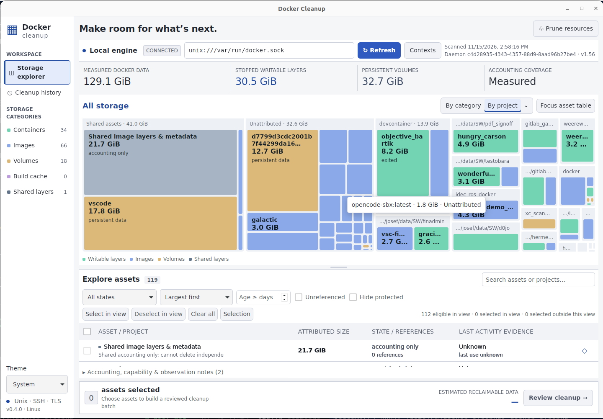

# Docker Cleanup

[](https://github.com/JNevrly/docker-cleanup/actions/workflows/ci.yml)
[](LICENSE)
[](https://github.com/JNevrly/docker-cleanup/releases)

**Find the Docker data taking up space. Understand it before deleting it.**

Docker Cleanup is a Linux desktop storage explorer built with Tauri, React and
Rust. Investigate old development containers, images and volumes, then review
exactly what a cleanup batch will remove—and what it will retain.



## What it does

- **See the big picture:** size-based treemaps grouped by category or project,
  searchable/sortable asset tables and readable full-name disclosure.
- **Understand ownership:** Compose/devcontainer clues, mount boundaries,
  lifecycle evidence, friendly names, project overrides and protected assets.
- **Investigate on demand:** changed filesystem paths, redacted metadata and
  container process evidence—without starting stopped containers.
- **Clean deliberately:** explicit-target review, separate volume/cache
  acknowledgements, per-action progress, cancellation and local cleanup history.
- **Choose your Engine:** direct local Unix sockets, or existing SSH/verified
  mutual-TLS Docker contexts.
- **Make the workspace yours:** Light/Dark/System themes, resizable panes and
  keyboard-accessible navigation.

## Install

Download the **Linux amd64 Debian package** and its `.sha256` file from
[GitHub Releases](https://github.com/JNevrly/docker-cleanup/releases).
For version **0.4.0**, in the directory containing the downloaded files:

```bash
sha256sum -c docker-cleanup_0.4.0_amd64.deb.sha256
sudo apt install ./docker-cleanup_0.4.0_amd64.deb
docker-cleanup
```

Close the application before upgrading. Run it as your normal desktop user,
**not root**. Debian 12/Linux amd64 is the native build/test baseline; installation
on other distributions has not been exhaustively validated. Windows, macOS,
ARM packages and AppImages are not provided.

### Connect and investigate

1. Enter `unix:///var/run/docker.sock` (rootful) or your rootless socket, often
   `unix:///run/user/1000/docker.sock`, then choose **Connect & scan**.
2. Explore by category/project and inspect an asset's evidence and mounts.
3. Select a small batch, choose **Review cleanup**, and verify the target and
   retained data before confirming.

Local sockets do **not** require Docker CLI. Remote SSH/TLS contexts do; configure
and verify them outside the app, then choose **Contexts** or enter `context://NAME`.
See the [user guide](docs/user-guide.md#remote-ssh-and-tls-contexts) for setup,
authentication requirements and limitations.

Docker socket access is highly privileged. The app does not repair socket
permissions, elevate privileges or fall back to an insecure remote transport.

## Safety and honest accounting

**Deletion is irreversible. There is no backup or undo.**

- No automatic container stops, forced image deletion or host-file deletion.
- Container deletion retains unselected volumes and external bind mounts.
- Volumes require an additional data-loss acknowledgement; protected assets are
  excluded from cleanup.
- Plans revalidate daemon identity, endpoint and references. A connection switch
  invalidates old plans; history cannot replay a deletion.
- Shared image data is counted once. Estimates are uncertain **logical-data**
  ranges, not guaranteed physical disk recovery.
- Unknown sizes/dates remain unknown. Changed paths are not per-directory sizes.

Remote transport is tested with real SSH/TLS against synthetic Engine APIs, not
an external production host. Actual rootless Engines, arbitrary drivers, hardware
keys and proxy configurations remain unvalidated. External buildx, deep directory
sizing and automatic cleanup policies are not supported.

## Develop and test

Requirements: Node.js 24 recommended (22.12+), Rust **1.100.0** (pinned),
Python **3.11+**, and Tauri's Linux build dependencies. On Debian 12:

```bash
sudo apt-get update
sudo apt-get install build-essential pkg-config libwebkit2gtk-4.1-dev \
  libssl-dev librsvg2-dev libayatana-appindicator3-dev patchelf libxdo-dev
npm ci
npm run desktop
```

For a browser-only preview, use `npm run dev`. It is explicitly marked
**SYNTHETIC DATA**; cleanup actions are simulations and do not contact Docker.

```bash
npm test
npm run format:check
npm run build
cargo test --locked --manifest-path src-tauri/Cargo.toml
python3 -m unittest discover -s tests -p 'test_*.py' -v
npx playwright install chromium
npm run test:e2e -- --workers=2
```

`bash scripts/build-linux.sh` produces a locked build with normalized Debian
archive metadata; Python 3 and `dpkg-deb` are required. Build output is in
`src-tauri/target/release/bundle/deb/`. Remote support's Docker CLI is optional
at runtime, not a packaging requirement.

## Documentation

- [User guide](docs/user-guide.md)
- [Capabilities and limitations](docs/capabilities.md)
- [Testing, native smoke checks and disposable Docker setup](docs/testing.md)
- [0.4.0 release notes](docs/releases/v0.4.0.md)
- [Maintainer release procedure and GitHub CI](docs/releasing.md)
- [Directory-analysis feasibility decision](docs/storage-analysis-decision.md)

History is stored privately under the platform application-data directory in
`io.github.docker-cleanup.app/history.sqlite`. It can contain workspace paths and
object metadata; treat it as sensitive. No background daemon runs after app exit.
Review logs/screenshots before including them in a
[bug report](https://github.com/JNevrly/docker-cleanup/issues).

## License

[MIT](LICENSE). Third-party dependencies retain their respective licenses.
